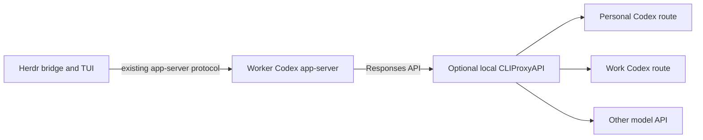

# Codex through CLIProxyAPI

Research date: 2026-10-21. Related: #136 and [the earlier account-switching investigation](codex-accounts.md).

## Scope and evidence

Inspected the public CLIProxyAPI source at **v8.0.36**, commit **`20c9095cac089c6a8e40554debe4dd8a19d4c14f`** (latest public release when checked; published 2026-10-20). The release tag resolves to that exact commit. All source links below are pinned. Read its root `AGENTS.md`; made no changes to the upstream project. This is source/documentation research: **no authenticated inference, OAuth login, credential import, production configuration change, or end-to-end Codex compatibility test was performed**. Source tests mentioned below were inspected, not executed. [Release](https://github.com/router-for-me/CLIProxyAPI/releases/tag/v8.0.36), [source](https://github.com/router-for-me/CLIProxyAPI/tree/20c9095cac089c6a8e40554debe4dd8a19d4c14f).

## Assessment

CLIProxyAPI is a credible optional inference gateway for Codex, including subscription-account pools and other model providers. It has considerably more explicit Codex compatibility than a generic Chat Completions proxy. It does not establish that every Codex feature works with every translated model, or automatically turn multiple subscription accounts into one accurate usage meter. The gateway should own upstream credentials and routing; Herdr should retain account-aware quota observations and show the route used. That assessment follows from the implementation details below.

## Verified proxy capabilities

### Codex transports and model discovery

- The server exposes `POST /v1/responses`, `GET /v1/responses` for WebSocket, and `POST /v1/responses/compact`. It also exposes corresponding `/backend-api/codex` aliases for `chatgpt_base_url` compatibility. [Routes](https://github.com/router-for-me/CLIProxyAPI/blob/20c9095cac089c6a8e40554debe4dd8a19d4c14f/internal/api/server_routes.go#L64-L126).
- The Codex executor sends to the ChatGPT Codex backend by default. It has a separate compact path, and optional Sign in with ChatGPT token handling for the OpenAI Responses endpoint. This is not merely a Chat Completions facade. [Execution](https://github.com/router-for-me/CLIProxyAPI/blob/20c9095cac089c6a8e40554debe4dd8a19d4c14f/internal/runtime/executor/codex_executor_execute.go#L23-L36), [compact execution](https://github.com/router-for-me/CLIProxyAPI/blob/20c9095cac089c6a8e40554debe4dd8a19d4c14f/internal/runtime/executor/codex_executor_execute.go#L229-L276), [SIWC credentials](https://github.com/router-for-me/CLIProxyAPI/blob/20c9095cac089c6a8e40554debe4dd8a19d4c14f/internal/runtime/executor/codex_executor_auth.go#L21-L66).
- Upstream Codex WebSocket use requires both a WebSocket downstream and a credential with WebSocket enabled; otherwise it uses HTTP. Compact and WebSocket upgrade failures have HTTP fallback. Experimental full-duplex steering is separately disabled by default and keeps one account/model per socket. Thus ordinary HTTP/SSE is the conservative first evaluation path; WebSocket continuity/failover deserves its own test. [Transport selection](https://github.com/router-for-me/CLIProxyAPI/blob/20c9095cac089c6a8e40554debe4dd8a19d4c14f/internal/runtime/executor/codex_websockets_executor.go#L19-L100), [steering configuration](https://github.com/router-for-me/CLIProxyAPI/blob/20c9095cac089c6a8e40554debe4dd8a19d4c14f/config.example.yaml#L335-L342).
- **Codex-native catalog discovery exists.** `/v1/models?client_version=...` returns the Codex catalog shape, rather than the ordinary OpenAI `data` list. It synthesizes model instructions, context windows, modalities, tool capabilities, and version-dependent metadata. `enable-apply-patch` and multi-agent compatibility affect that catalog. This is useful source evidence, but the actual client must request that catalog; a custom provider that never discovers models may still need an explicit model catalog. [Model endpoint](https://github.com/router-for-me/CLIProxyAPI/blob/20c9095cac089c6a8e40554debe4dd8a19d4c14f/sdk/api/handlers/openai/openai_handlers.go#L61-L90), [catalog adapter](https://github.com/router-for-me/CLIProxyAPI/blob/20c9095cac089c6a8e40554debe4dd8a19d4c14f/sdk/api/handlers/openai/codex_client_models.go#L9-L29), [catalog construction](https://github.com/router-for-me/CLIProxyAPI/blob/20c9095cac089c6a8e40554debe4dd8a19d4c14f/internal/client/codex/models/models.go#L374-L588).

### Account pools, weights, and stickiness

- The routing strategies are `round-robin` (default), `weighted-round-robin`, and `fill-first`. OAuth/file credentials accept an explicit top-level numeric `weight`; default is 1. Setting weights 5 and 1 is possible. This is a **configured routing share**, not automatic inference of subscription size or a guarantee of 5:1 token consumption: request sizes differ, unavailable credentials are excluded, and sticky sessions retain their bound account. [Configuration](https://github.com/router-for-me/CLIProxyAPI/blob/20c9095cac089c6a8e40554debe4dd8a19d4c14f/config.example.yaml#L148-L171), [weight lookup and selection](https://github.com/router-for-me/CLIProxyAPI/blob/20c9095cac089c6a8e40554debe4dd8a19d4c14f/sdk/cliproxy/auth/selector.go#L378-L397), [weighted selector](https://github.com/router-for-me/CLIProxyAPI/blob/20c9095cac089c6a8e40554debe4dd8a19d4c14f/sdk/cliproxy/auth/selector.go#L672-L712).
- Optional universal `session-affinity` prefers explicit Codex session headers and then cache/conversation/session identities. Its default TTL is one hour. When enabled, child agents inherit the parent's account by default; that can be disabled for greater distribution. Existing session bindings outrank recovered higher-priority accounts. [Configuration](https://github.com/router-for-me/CLIProxyAPI/blob/20c9095cac089c6a8e40554debe4dd8a19d4c14f/config.example.yaml#L154-L178).
- **Stickiness is not an account-isolation guarantee:** unavailable bound accounts automatically fail over. `session-affinity-rebind-on: quota` limits rebinding after transient failures but still permits it after quota/auth/model-support failures. Retry rounds, credential caps, cooldown waits, and optional persisted cooldown state are configurable. [Affinity and failure settings](https://github.com/router-for-me/CLIProxyAPI/blob/20c9095cac089c6a8e40554debe4dd8a19d4c14f/config.example.yaml#L158-L218).
- For deliberate personal/work separation, credential prefixes can expose `personal/<model>` and `work/<model>`. With `routing.force-model-prefix: true`, prefixed credentials stop publishing unprefixed aliases, except the documented prefix-equals-model special case. The prefix is read from OAuth credential metadata; model publication applies that prefix. Use unique prefixes and avoid creating shared aliases across boundaries. **For a hard initial boundary, separate proxy instances/configurations/auth directories with only the intended credentials are easier to audit**; do not treat affinity as that boundary. This last recommendation is an architectural inference, not a live isolation test. [Prefix configuration](https://github.com/router-for-me/CLIProxyAPI/blob/20c9095cac089c6a8e40554debe4dd8a19d4c14f/config.example.yaml#L180-L181), [OAuth metadata parsing](https://github.com/router-for-me/CLIProxyAPI/blob/20c9095cac089c6a8e40554debe4dd8a19d4c14f/internal/watcher/synthesizer/file.go#L198-L220), [model prefix publication](https://github.com/router-for-me/CLIProxyAPI/blob/20c9095cac089c6a8e40554debe4dd8a19d4c14f/sdk/cliproxy/service_models.go#L704-L747).

### Usage and quota are separate data streams

- Passive upstream quota observations are tracked **per upstream credential**, including observed timestamp, plan, primary/secondary window fields, credits, and additional model limits. Codex WebSocket `codex.rate_limits` frames are normalized into the same header-like representation as HTTP quota observations. [Event normalization](https://github.com/router-for-me/CLIProxyAPI/blob/20c9095cac089c6a8e40554debe4dd8a19d4c14f/internal/runtime/executor/helps/codex_quota.go#L16-L112), [recognized quota signals](https://github.com/router-for-me/CLIProxyAPI/blob/20c9095cac089c6a8e40554debe4dd8a19d4c14f/sdk/cliproxy/auth/quota_signals.go#L150-L170).
- `GET /v8/management/credentials` exposes account identifiers, availability, `quota.observed_at`, `quota.signals`, and `model_quotas`. The source explicitly distinguishes passive quota observations from scheduler cooldown state. The v8 routes use **plugin quota APIs** for active checks; do not copy old `/v0/management/quota/fetch` examples into a new v8 integration. Credential entries advertise quota support/plugin IDs when such a plugin is installed. [Management routes](https://github.com/router-for-me/CLIProxyAPI/blob/20c9095cac089c6a8e40554debe4dd8a19d4c14f/internal/api/server_management_v8.go#L39-L63), [credential entries](https://github.com/router-for-me/CLIProxyAPI/blob/20c9095cac089c6a8e40554debe4dd8a19d4c14f/internal/api/handlers/management/auth_files.go#L647-L708), [observation payload](https://github.com/router-for-me/CLIProxyAPI/blob/20c9095cac089c6a8e40554debe4dd8a19d4c14f/internal/api/handlers/management/auth_files.go#L810-L832).
- Source usage records can identify upstream `AuthID`/`AuthIndex`, model/alias, session/parent session, token counts, latency, failures, and response headers. These measure observed proxy requests; they do not measure subscription consumption from other direct clients. [Usage record](https://github.com/router-for-me/CLIProxyAPI/blob/20c9095cac089c6a8e40554debe4dd8a19d4c14f/sdk/cliproxy/usage/manager.go#L23-L102).
- The management usage queue is a **destructive pop**, not a passive shared read. A collector should own consumption and persist records if Herdr needs reliable history. Usage statistics are disabled in the sample configuration. [Queue handler](https://github.com/router-for-me/CLIProxyAPI/blob/20c9095cac089c6a8e40554debe4dd8a19d4c14f/internal/api/handlers/management/usage.go#L23-L49), [statistics default](https://github.com/router-for-me/CLIProxyAPI/blob/20c9095cac089c6a8e40554debe4dd8a19d4c14f/config.example.yaml#L1174-L1181).
- **Codex's own displayed limits are not automatically a pooled meter.** Header passthrough is disabled by default; the Responses SSE handler explicitly strips `codex.rate_limits`, including for official Codex clients. Enabling header passthrough would at most expose the selected upstream account's response, not the pool's complete current state. Read per-account management observations instead, check freshness, and label unavailable/stale values honestly. [Header default](https://github.com/router-for-me/CLIProxyAPI/blob/20c9095cac089c6a8e40554debe4dd8a19d4c14f/config.example.yaml#L237-L239), [private SSE filtering](https://github.com/router-for-me/CLIProxyAPI/blob/20c9095cac089c6a8e40554debe4dd8a19d4c14f/sdk/api/handlers/openai/openai_responses_handlers.go#L141-L169).

### Other providers, tools, compaction

- API-key OpenAI-compatible providers can be added behind the gateway, with aliases and explicit context/modalities/reasoning metadata. The sample includes Kimi, DeepSeek, and GLM model aliases. This establishes routing extensibility, **not those models' coding quality or exact provider support**. [Provider/model configuration](https://github.com/router-for-me/CLIProxyAPI/blob/20c9095cac089c6a8e40554debe4dd8a19d4c14f/config.example.yaml#L888-L916).
- The generic OpenAI-compatible executor translates incoming Responses requests to upstream **Chat Completions**. It has tool/history translation and emits Responses-shaped outputs. Responses freeform/custom tools become JSON function tools with an `input` string; `apply_patch` has special description/schema and response restoration handling. It recognizes namespace and `additional_tools` declarations. Consequently, tool-call plumbing exists, but grammar-constrained custom tool generation is not equivalent to native Responses semantics; the upstream model still has to follow the tools well. [Executor](https://github.com/router-for-me/CLIProxyAPI/blob/20c9095cac089c6a8e40554debe4dd8a19d4c14f/internal/runtime/executor/openai_compat_executor.go#L120-L164), [custom tool conversion](https://github.com/router-for-me/CLIProxyAPI/blob/20c9095cac089c6a8e40554debe4dd8a19d4c14f/internal/translator/openai/openai/responses/openai_openai-responses_tools.go#L235-L263), [tool identity index](https://github.com/router-for-me/CLIProxyAPI/blob/20c9095cac089c6a8e40554debe4dd8a19d4c14f/internal/translator/openai/openai/responses/responses_tool_index.go#L108-L133), [apply_patch response tests](https://github.com/router-for-me/CLIProxyAPI/blob/20c9095cac089c6a8e40554debe4dd8a19d4c14f/internal/translator/openai/openai/responses/openai_openai-responses_response_test.go#L1692).
- `client.codex.enable-apply-patch` defaults to false for models that do not natively advertise freeform patching. `optimize-multi-agent-v2` also defaults to false and adjusts model details, encrypted agent messages, and non-Codex delegation input. These are compatibility features to validate intentionally, not settings to enable indiscriminately. [Compatibility configuration](https://github.com/router-for-me/CLIProxyAPI/blob/20c9095cac089c6a8e40554debe4dd8a19d4c14f/config.example.yaml#L315-L327).
- **Compaction is a concrete cross-provider risk.** For a generic Chat Completions-compatible upstream, compact requests switch to `/responses/compact` and are sent there. The inspected executor does not synthesize a general Chat Completions summarizer for this endpoint. An upstream implementing only `/chat/completions` can therefore fail at compaction even if initial tool turns succeed. Native Codex compact has a dedicated implementation and regression tests. [Generic compact handling](https://github.com/router-for-me/CLIProxyAPI/blob/20c9095cac089c6a8e40554debe4dd8a19d4c14f/internal/runtime/executor/openai_compat_executor.go#L120-L171), [native compact tests](https://github.com/router-for-me/CLIProxyAPI/blob/20c9095cac089c6a8e40554debe4dd8a19d4c14f/internal/runtime/executor/codex_executor_compact_test.go#L17-L82).

## Authentication integration choices

The proxy's current [Codex setup guide](https://help.router-for.me/agent-client/codex) recommends native ChatGPT sign-in, a custom provider with `wire_api = "responses"`, `requires_openai_auth = true`, and an `X-Api-Key` carrying the local proxy key. Its API-mode example also uses `requires_openai_auth = true`, but replaces `auth.json` with an `OPENAI_API_KEY`. Neither example uses `env_key`. This guide is mutable web documentation, not a commit-pinned artifact.

For Herdr, a separately selectable provider with `requires_openai_auth = false` and a dedicated environment-variable proxy key is worth evaluating as a deliberate alternative to these examples. It would let the gateway own upstream OAuth and avoid implying that the native `~/.codex` login identifies the account actually selected for inference. **That is an integration proposal, not a tested recipe from this investigation.** It must be checked against the pinned Codex version, model discovery, app-server initialization, and the company's account/managed-policy requirements. Consult the current [official Codex configuration reference](https://learn.chatgpt.com/docs/config-file/config-reference) for provider authentication fields.

When the proxy does use upstream Codex OAuth, it sets `Chatgpt-Account-Id` from the selected proxy credential metadata. This reinforces the difference between the native client's signed-in identity and the gateway-selected inference account. [Upstream identity header](https://github.com/router-for-me/CLIProxyAPI/blob/20c9095cac089c6a8e40554debe4dd8a19d4c14f/internal/runtime/executor/codex_executor_request.go#L294-L309).

The inspected source does not establish that gateway authentication reproduces Business workspace policy fetches, ChatGPT-connected services, or native account identity APIs. Ordinary local tools and MCP tool schemas can pass through the inference tool interface, but account-bound product capabilities and policy behavior require separate verification. Do not infer their equivalence from a successful Responses request.

## Suggested compatibility experiment

Use an isolated optional provider/profile and a release-pinned loopback proxy. Test one Codex account first, then a second explicitly identified account, then one chosen non-OpenAI provider. Preserve the existing direct route throughout evaluation. Success criteria:

1. Discover and select the real model with correct context window, reasoning levels, and tool capabilities.
2. Complete shell/file/function tools, freeform `apply_patch`, parallel calls, and an existing MCP tool.
3. Resume after process restart and after enough context to trigger compaction.
4. Spawn a child agent and verify actual model/account routing and session affinity.
5. Exercise mock/local quota and upstream failure responses to verify retry, cooldown, session rebinding, cancellation, and stream behavior without consuming production quota deliberately.
6. Reconcile observed per-account quota freshness and reset windows with the provider's own values; separately attribute proxy usage to upstream account and model.
7. Verify personal/work boundaries and account-bound policy/identity behavior before routing company repositories through a pool.

The recommendation is a bounded evaluation, not a claim that this end-to-end matrix has passed.

## Herdr integration and the existing account research

**[Source / recommendation]** The earlier [#136 research](codex-accounts.md) is already complete. Its global-switch NO-GO still applies: a worker's cached account can survive a disk switch initially but later fail guarded refresh. A proxy that owns and refreshes upstream credentials removes that particular dependency from inference; Herdr can retain the shared app-server and remote TUI arrangement:



The distinction matters: earlier alternatives rejected in [#135](https://github.com/JeffreyVdb/herdr-3d/issues/135) proxied the TUI/app-server link. CLIProxyAPI handles model requests behind app-server, so it does not compete for Herdr's control connection. This is an architectural inference from [Herdr's launcher](../../internal/codexapp/launch.go) and the proxy endpoints described above, not a demonstrated hire/wake run.

The existing meter will not become pooled just because inference uses a proxy:

- [probeCodex](../../internal/limits/codex.go) starts its own app-server and calls `account/rateLimits/read`. In [Codex 0.163's account processor](https://github.com/openai/codex/blob/83086188ae0614bd882818ff1aa23f3194962012/codex-rs/app-server/src/request_processors/account_processor.rs#L1192), that method uses the local account auth manager and `chatgpt_base_url`, independently of the model provider's inference URL. It may fail without ChatGPT credentials, or describe the local login even when the proxy routes inference elsewhere.
- [Server limits state](../../internal/server/limits.go) and the [frontend LimitBook](../../game/src/world/limits.ts) retain one reading per provider; [proto.Limits](../../internal/proto/limits.go) has no account identity. Multi-account readings need stable account keys, per-window timestamps and reset times. Proxy quota observations need a distinct source and freshness status.
- Under proxy-owned upstream auth, native `account/read` cannot establish which upstream credential served a request. #139's identity guarantee needs proxy routing evidence. Session affinity can fail over; it is not an account lock.
- [Model discovery](../../internal/harness/models.go) currently probes one effective Codex configuration at startup. Multiple inference profiles need profile-specific discovery and persisted provider/route selection across [hire](../../internal/server/codexserver.go) and [wake](../../internal/server/codexfloor.go). Check the proxy's Codex catalog against each actual upstream; catalog metadata cannot manufacture model capabilities. [Official gateway metadata guidance](https://learn.chatgpt.com/docs/enterprise/roll-out-a-gateway#use-a-model-catalog-for-custom-names).

Keep personal and company routes explicit, consistent with #135's existing repo/account rules. The available pool for a worker includes only credentials allowed for that repository and able to serve its chosen model. A company-only worker must not report personal capacity as available to it.

## What “120% usage” should mean

**[Calculation / product recommendation]** Using the user's stated nominal allowances, Pro Light contributes 5 Plus-equivalent units and Standard Business contributes 1. Together that is **6× Plus, or 120% of a 5× Pro Light reference**. No proxy is required to implement that display.

| Capacity | Plus-equivalent units | Share of combined pool |
| --- | ---: | ---: |
| Pro Light | 5 | 83.33% |
| Standard Business | 1 | 16.67% |
| Combined | 6 | 100% |

For a comparable window and eligible model, let `p` and `b` be the accounts' **used percentages**, each 0–100:

```text
combined used % = (5 × p + b) / 6
used % relative to Pro Light capacity = p + b / 5
remaining % relative to Pro Light capacity = (100 − p) + (100 − b) / 5
```

For example, if Pro is exhausted and Business untouched, the combined meter is 83.33% used with 16.67% remaining. Exhausting both corresponds to 100% of the pool and 120% of the Pro Light reference. Simply adding account percentages gives the wrong answer.

Recommended presentation: a 0–100% combined meter labelled **“6× Plus capacity · 120% of Pro Light”**, with each account's native percentages, eligibility, reset time and observation freshness underneath. Mark the combined capacity as an estimate. These equations describe a weighted snapshot; they are not an accumulated token counter across resets.

**[Official docs / limitation]** Current [OpenAI pricing documentation](https://learn.chatgpt.com/docs/pricing#what-are-the-usage-limits-for-my-plan) says Pro plans have no five-hour limit, whereas Plus and Standard Business have five-hour estimates. Weekly limits can apply; model, context and speed affect consumption. Consequently, a literal 5:1 merge of five-hour percentages is not valid for these plans today. Only aggregate like-for-like windows when weights are established, and retain different reset schedules and model-specific limits. Missing windows are not zero usage. The 5× weight here comes from the user's plan description; this research did not verify the user's entitlement or establish a fixed token budget from it.

For future API-backed models, show provider spend/budget and request limits separately. A dollar budget or tokens from another model has no automatic conversion to a Codex subscription percentage.

## Recommendation and remaining qualification

**Proceed with an optional proxy experiment; retain per-account usage as the authoritative detail.** CLIProxyAPI is a plausible inference backend for avoiding dependence on OpenAI models while keeping Codex's local execution and Herdr integration. It does not itself solve Herdr's usage model, account attribution or work/personal routing.

Implement account-aware quota readings independently of the transport decision. Qualify the proxy with the installed **Codex 0.163.0** and a pinned proxy release before relying on it for workers. The useful end-to-end checks are streamed completion, a shell/tool call and result, `apply_patch`, a follow-up turn, long-context compaction, interrupt/resume, sleep/wake, and explicit upstream identity/quota attribution. Repeat the model/tool/compaction checks with one actual non-OpenAI backend; successful OpenAI routing does not establish translation compatibility. [OpenAI's gateway compatibility requirements](https://learn.chatgpt.com/docs/enterprise/gateway-compatibility).

Keep the selected provider/model stable for a conversation unless cross-provider history and continuation have been tested. Use route-specific configuration on every launch and wake, and surface failures rather than treating a fallback account as the requested identity. Local MCP and plugin connections can have their own credentials and network paths, outside model inference; a proxy route does not transfer account-managed features or policies.

**Evidence boundary:** this investigation inspected public primary sources, GitHub issue context, the local Herdr implementation and `codex --version`. It did not install/configure the proxy, access or copy account credentials, run authenticated model inference, or validate an actual Herdr worker through it. The compatibility verdict is “credible candidate for a prototype,” not a production compatibility certification.
