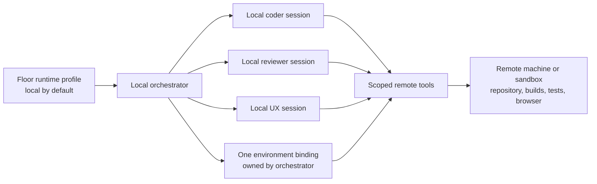

# Remote agent runtimes

Checked 2026-10-09 using Alterlab MCP web search and page extraction. This is an investigation, not an implementation or ticket. No runtime was provisioned and no candidate was exercised with a live coding session.

## Finding

The proposed split is feasible: keep the Claude Code/Codex process and conversation on the Herdr machine, and give it tools that execute commands and manipulate files on another machine. Existing SSH MCP servers already implement that pattern for both agents. They do not automatically redirect the agents' built-in local tools; Herdr would still need to configure tools, repository preparation, shared runtime ownership, and lifecycle.

Distinguish this from keeping the interface local while moving the entire agent process to a server. Both vendors offer the latter. Their self-hosted cloud products also move session execution away from this machine, but do not preserve a locally running harness.

Here, **harness** means the agent process that owns the conversation and tool loop. A remote tool or executor runs commands/filesystem operations without necessarily owning that loop.

## Existing options

| Option | What stays local | What runs remotely | Both Claude Code and Codex? | Fit |
|---|---|---|---|---|
| SSH MCP server | Agent harness and Herdr | Shell, file operations, forwarded services | Explicitly supported by the projects below | Closest fit for an existing server per orchestrator |
| Daytona MCP | Agent harness and Herdr | Provisioned sandbox, files, Git, processes, previews | Claude documented; Codex compatibility follows from standard MCP, requires validation | Closest fit when Herdr should create and remove sandboxes |
| DevPod | Workspace provisioning client and IDE/UI | Dev container on chosen infrastructure | Agent-independent infrastructure; both CLIs can be installed | Useful environment provider; still needs remote tools or remote agent launch |
| Native remote agent sessions | Interface and Herdr | Full Claude Code or Codex app-server | Vendor-specific implementations exist | Good alternative if local conversation-process ownership can change |
| Native self-hosted cloud environments | Application/client | Agent execution on own compute; vendor control plane/harness involvement | Separate vendor products | Larger integration change; does not retain the existing local sessions |

### SSH MCP: concrete existing implementations

[remote-shell-mcp](https://github.com/jaenster/remote-shell-mcp) explicitly supports Claude Code CLI and Codex CLI. Its tools cover SSH commands, persistent PTY sessions, SFTP read/write/upload/download, port forwards, and Docker operations over SSH. A daemon preserves SSH sessions and forwards across client restarts; a stdio launcher connects each MCP client to that daemon. The README includes client configuration and installation instructions for both agents.

This fits a single server shared by one orchestrator's workers. Persistent command sessions and port forwarding are particularly relevant to long test runs and UX review. The project supplies connectivity, not floor configuration or an orchestrator-aware repository lifecycle. Its published capabilities and tests were read, not independently verified.

[mcp-ssh-manager](https://github.com/bvisible/mcp-ssh-manager) is a second implementation explicitly targeting Claude Code and OpenAI Codex. It offers multiple SSH connections, command execution, file transfer/synchronization, per-server policies, and optional SSH-agent forwarding. It demonstrates that this is an established integration pattern, rather than requiring a new vendor-specific agent runtime. Selecting either dependency would need a concrete evaluation against Herdr's requirements and a pinned version; this research is not a production endorsement.

### Daytona MCP: sandbox lifecycle and execution

[Daytona's MCP documentation](https://www.daytona.io/docs/en/mcp/) describes sandbox management, filesystem and Git operations, process/code execution, computer use, and previews. Its local `daytona mcp start` process exposes the provider's remote capabilities to an MCP client. The documented automatic initialization targets Claude, Cursor, and Windsurf; other agents receive a generated MCP configuration.

Codex supports stdio MCP servers, so a manual Codex configuration should work with the same server. This is an interoperability inference, not a verified Daytona Codex recipe. The product is a provider for sandboxes rather than an arbitrary SSH host connector. It is a stronger candidate when the orchestrator should allocate compute and prepare a repository through provider APIs.

### DevPod: reusable development environments

[DevPod's architecture](https://devpod.sh/docs/how-it-works/overview) provisions dev containers using providers such as Docker, Kubernetes, and cloud machines, connects through SSH, and supports forwarded ports and logs. Its [credential documentation](https://devpod.sh/docs/developing-in-workspaces/credentials) describes Git HTTPS credential helpers and SSH-agent forwarding, directly addressing private repository access.

DevPod does not document automatic replacement of Claude Code or Codex tools with remote tools. It can provide the machine/container and repository access beneath either approach: connect a local harness through SSH MCP, or run the full CLI inside the workspace. Agent compatibility here is an architectural inference from an ordinary development environment, not a tested agent integration.

### Vendor remote UI and cloud alternatives

[Claude Remote Control](https://code.claude.com/docs/en/remote-control) keeps the Claude process, filesystem, and command execution on the machine where the session started; another device receives an interface. Starting Claude on a server would offload execution, but starting it on this machine and enabling Remote Control would not. This is different from adding remote execution tools to a local process.

[Claude self-hosted environments](https://code.claude.com/docs/en/self-hosted-environments) are public beta for Team/Enterprise cloud sessions. An organization-operated runner claims sessions, clones their GitHub repository using configured credentials, and starts Claude Code on the runner host. They do not reroute an ordinary existing local terminal or IDE session. The runner can execute several sessions, but vendor placement is not a substitute for Herdr's requirement that one orchestrator's workers share the chosen environment.

[Codex app-server](https://developers.openai.com/codex/app-server/) documents a remote terminal UI connecting with `codex --remote` to an app-server elsewhere. That moves the harness with execution. The same reference also documents experimental `environment/info` for named execution environments, and `--code-mode-host` for a remote Code Mode host. These are useful leads for a native local-harness/remote-executor integration. They are distinct interfaces: the Code Mode host flag alone is not evidence that all shell and filesystem tools are routed to a remote executor. The inspected public configuration reference did not establish a complete supported configuration recipe. Validate the installed version and protocol before relying on this alternative; the WebSocket transport is explicitly experimental.

[OpenAI Agents API self-hosted sandboxes](https://developers.openai.com/api/docs/guides/agents-api/environments/self-hosted) explicitly separate an OpenAI-hosted harness from `codex exec-server` on user-controlled compute. The executor handles shell/files/local MCP and connects outbound. Each session has its own environment ID and needs its own executor. Sessions can use the same physical machine or mounted storage, but sharing an executor is not the documented model. This provides Codex-based self-hosted execution today, while requiring a move from local Codex CLI conversations to Agents API sessions.

[Docker cloud sandboxes](https://docs.docker.com/ai/sandboxes/cloud/) are another whole-agent alternative: the local `sbx` CLI creates a Docker-managed sandbox and attaches to its agent. Cloud sandboxes do not mount the local workspace; cloning or transferring files is required. Local Docker isolation alone does not remove CPU load from this machine. Docker's [supported agents](https://docs.docker.com/ai/sandboxes/agents/) include Claude Code and Codex, although cloud authentication and support must be checked separately from the local agent list.

## Consequences for the proposed feature

The strongest starting point is a runtime profile selected per floor, defaulting to local, with one concrete runtime owned by an orchestrator run and inherited by its coder, UX, and reviewer sessions. Profiles choose infrastructure; runtime instances carry the actual machine/sandbox, checkout paths, connection state, and services. Sharing one machine does not require sharing one agent process or conversation.

A prompt block should describe the resolved runtime, repository/worktree paths, tool names, service URLs, and conventions for commands and Git. It cannot by itself guarantee that CPU-heavy commands run remotely. Local filesystem tools can also inspect or edit a different copy than the remote tests exercise, so execution and repository access need an explicit routing policy.

Claude's [custom tool reference](https://code.claude.com/docs/en/agent-sdk/custom-tools) provides the relevant mechanism: SDK MCP tools can call arbitrary handlers, while the `tools` option removes unlisted built-in tools; `tools: []` leaves MCP tools available. `allowedTools` only preapproves calls and does not remove other tools. A CLI or stream-json integration should validate its corresponding tool configuration surface rather than assume SDK options are directly interchangeable. Codex's [MCP reference](https://developers.openai.com/codex/mcp/) confirms stdio and Streamable HTTP support. Its separate built-in shell/file tools still require policy or a validated native execution environment; registering an MCP server alone does not redirect them.

Repository preparation should resolve a remote URL and ref, authenticate, clone/fetch, and prepare worker paths before agents start. A clone reproduces committed Git state; local uncommitted changes need a deliberate transfer path. A common environment should retain separate worker worktrees where concurrent editing would otherwise collide. UX review also needs remote browsers or forwarded preview URLs, and runtime teardown must preserve work and artifacts before removal. These are proposed design implications, not documented automatic behavior of the products above.

## Evidence limits and next validation

The research validates available products and documented architecture, not production reliability. Several Alterlab searches timed out; successful first-party extracts support the findings above. No software was installed and no private credentials were sent to a runtime.

The smallest useful follow-up experiment is one existing SSH server, one local Claude session, and one local Codex session using the same remote checkout through an SSH MCP. Demonstrate file edits, a long-running test with cancellation, repository authentication, a forwarded preview, reconnect, and artifact retrieval. Separately inspect Codex's native execution environment schema to determine whether it can preserve local conversations without replacing the built-in toolset. These experiments would settle the implementation choice before creating a ticket.

## Herdr integration: repository findings and proposed shape

The following is a design recommendation based on the checked-out repository, not an implemented feature or a runtime-tested integration.

### Ownership: floor defaults, orchestrator environments

Keep the floor setting as a **runtime profile**, defaulting to `local`. Resolve that profile into one concrete environment owned by each orchestrator. All of its CODE, REVIEW and UX workers inherit that binding across review rounds and replacement workers. Two orchestrators on one floor receive separate bindings. A floor default change should affect newly created bindings, rather than move active work.

Distinguish an existing SSH host from a provisioned machine: selecting `ssh buildbox` does not allocate another server for every orchestrator. A provider profile must specify whether it creates a dedicated VM/container, reserves an existing machine, or creates an isolated workspace on a shared host. Containers on the current overloaded machine do not add CPU capacity. Shared remote hosts still need CPU/memory allocation and test concurrency limits.

For the requested locality, keep the orchestrator and worker CLI sessions on the Herdr host. Put the authoritative repository checkout, compiler, tests, development server and browser used for E2E/UX work in the selected runtime. Give every local agent tools bound to that same environment. Sharing compute does not require sharing a Claude session or Codex app-server.

### What the current repository supports

| Existing integration point | Finding / consequence |
|---|---|
| [`internal/proto/proto.go`](../../internal/proto/proto.go), `FloorSettings`; [`internal/store/settings.go`](../../internal/store/settings.go) | A natural home for the selected runtime profile. Current fields cover repository, cwd, hire defaults and tracker; no runtime binding exists. |
| [`internal/server/runprompt.go`](../../internal/server/runprompt.go), `runPrompt` | Already composes the team and placement instructions for the orchestrator. Add a generated runtime section here, and pass the resolved section into every child brief. |
| [`internal/server/launch.go`](../../internal/server/launch.go), `runStart` | A user-edited `Prompt` replaces the composed prompt. Mandatory runtime context must also reach this path, preferably separately from editable task text. A prompt block alone cannot select an execution backend. |
| [`internal/server/runs.go`](../../internal/server/runs.go); [`internal/world/runs.go`](../../internal/world/runs.go) | The bridge already tracks orchestrator links and role/run metadata. Use an explicit durable orchestrator/runtime ID; labels and cwd are insufficient routing identities. |
| [`internal/herdr/hire.go`](../../internal/herdr/hire.go); [`internal/server/hire.go`](../../internal/server/hire.go) | Worktree creation and hire cwd currently address local Herdr workspaces. Local session cwd must be distinct from remote checkout cwd. |
| [`internal/server/files.go`](../../internal/server/files.go); [`internal/server/changes.go`](../../internal/server/changes.go); [`internal/gitops/gitops.go`](../../internal/gitops/gitops.go) | File indexing, Git status and Git commands address a local checkout. Remote work needs adapters or a deliberate local mirror for game features to show the actual changes. |
| [`internal/runs/report.go`](../../internal/runs/report.go) | Report polling reads local files. Keep report publication local through the local harness, or explicitly transfer/poll remote reports and artifacts. Remote report paths cannot be handed to the existing local reader. |
| [`internal/herdr/codexremote.go`](../../internal/herdr/codexremote.go); [`internal/codexapp/conn.go`](../../internal/codexapp/conn.go) | The existing Codex `Remote` means a local worker-owned Unix socket. It is not an SSH execution runtime; path validation and dialing explicitly assume local sockets. |
| [`internal/codexapp/launch.go`](../../internal/codexapp/launch.go); [`codex-shared-tui.md`](codex-shared-tui.md) | Each Codex server starts from its worker's initialized pane so its environment and Herdr identity remain correct. Keep per-worker app-servers even if tools target one shared machine. |
| [`docs/git-worktrees.md`](../git-worktrees.md) | E2E work also uses a host-wide lock. Separate machines can remove that shared contention; merely pointing all orchestrators at one remote machine may relocate it. |

### Provisioning and repository access

The orchestrator can request `ensure environment` and coordinate bootstrap, but a runtime service should perform repeatable provisioning and return a durable descriptor: profile ID, environment ID, owner ID, remote checkout, repository URL, revision, available tools and artifact/preview access. Repeating the request should reconnect to the existing environment.

Bootstrap should verify connectivity and toolchain, clone/fetch the actual repository using a credential reference, and create the run branch/worktree. A private clone requires repository authorization on the target: a scoped GitHub App token, deploy key, or another deliberate credential route. Host SSH access alone does not imply GitHub access. Keep credential values out of the prompt. Define push/PR authorization separately from clone access.

Git cloning also does not transfer an unpushed local commit, dirty working tree or untracked input. Either begin from an explicitly available remote revision or transfer that state deliberately. For full remote editing, the remote checkout is authoritative. For an optional first experiment that offloads only builds/tests, synchronize local edits before each job and return the tested revision/content identity so reviewers do not assess stale code.

Reviewers should examine the coder's recorded HEAD and working-tree state. They can share the checkout when coding has stopped, or use separate worktrees on the same machine if parallel edits are required. Use distinct terminals and report/artifact paths. Run both the browser and application remotely for E2E/UX, with a tunnel or preview and screenshot transfer back to the local session/game.

### Runtime prompt content

Generate a compact section with the resolved environment identity and tools, remote repository/worktree path, bootstrap status, revision/branch, setup/test commands, artifact/report publication route and preview access. Require the orchestrator to copy it into every child brief and preserve it on resume.

Tool configuration must make those instructions concrete: remote file reads/writes and patches, shell execution, process polling/stdin/cancellation, Git operations and browser access must reach the selected runtime. Local Herdr control and local report publication still need to work. Native local workspace tools must be denied, replaced, or constrained where they would bypass that route. An unavailable remote runtime should produce a visible failure, rather than silently run heavy commands locally.

Record environment lifecycle independently from worker lifecycle: sending a reviewer home should not destroy shared compute. Define stop/resume/reconnect, failed bootstrap cleanup, retention of dirty work and artifacts, and release of a dedicated server when its orchestrator ends. Keep these policies explicit before provider integration.

### Recommendation and remaining validation

Start with one existing SSH machine and a scoped MCP/tool adapter, investigating `remote-shell-mcp` as reusable transport. This matches both CLI harnesses and the requested local sessions. Keep a provider-neutral runtime profile/binding so a dedicated VM or Daytona-style sandbox can be added later. The MCP package is a candidate dependency, not a verified production selection or a ready-made Herdr ownership layer.

Before implementation, a small mixed Claude/Codex feasibility probe should prove: local sessions retain Herdr identity; all heavy work and repository mutations happen remotely; both agents review the same revision; long-running E2E output and cancellation work; UX can access remote previews and screenshots; private cloning works without prompt secrets; reconnect/resume retains the binding; and two orchestrators cannot accidentally use each other's checkout or process IDs. Inspect package provenance, release pinning and tool access scope as part of that probe.

No servers were provisioned, no credentials or installed agent configuration were changed, and no ticket was created during this investigation. Local checks were source inspection and CLI version/help only: Codex 0.162.0 and Claude Code 2.1.295.
